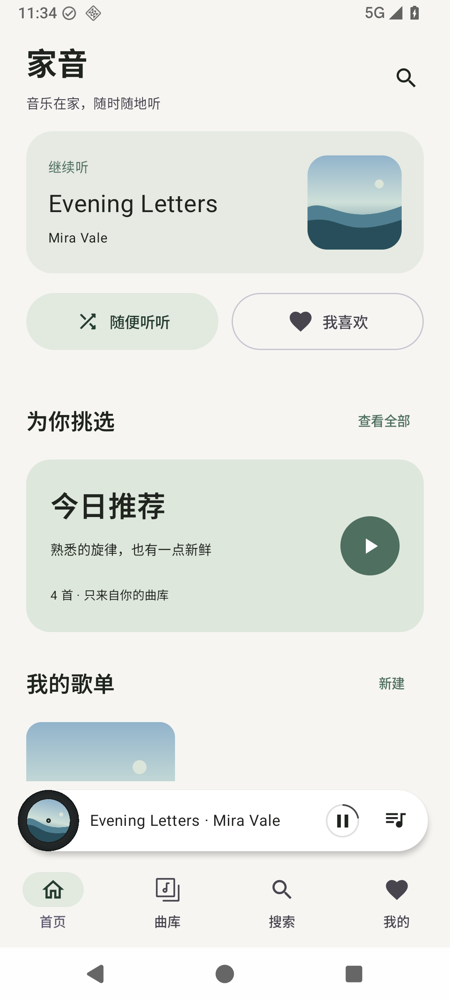
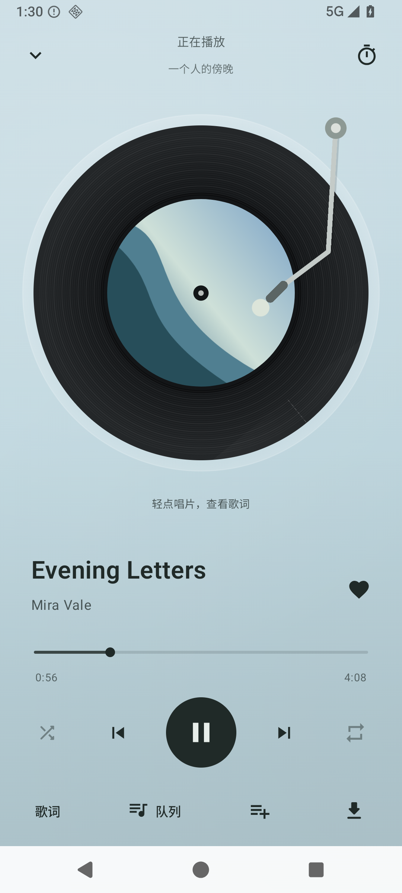

# 家音 / Jiayin

适合使用群晖（Synology）、威联通（QNAP）等 NAS 作为音乐服务器的开源 Android 音乐播放器。连接 NAS 上部署的 Navidrome 或兼容 Subsonic 服务，随时播放自己的音乐库。

基于 [Tempus v4.30.0](https://github.com/eddyizm/tempus/tree/v4.30.0)，使用 Kotlin、Jetpack Compose 与 Media3，继续遵循 [GPL-3.0](LICENSE)。

**这是预览版，目前主要界面为简体中文。你需要自己的 Navidrome 或兼容 Subsonic 的音乐服务；本项目不提供音乐、公共服务器或共享账户。**

## 下载与连接

从 [Releases](https://github.com/VangelisZhu/jiayin/releases) 下载签名 APK。Android 7.0（API 24）及以上可安装；实际后台播放兼容性需在自己的手机验证。

1. 确保手机能访问你的音乐服务。公网使用 HTTPS；局域网可使用本地 HTTP 地址。
2. 首次打开，填写**音乐服务的基础地址、自己的用户名和密码**。不要填 NAS 系统管理页面地址，也不需要手工追加 `/rest`。
3. 连接成功后同步曲库。家音不会内置、猜测或访问某个人的服务器。
4. “随便听听”持续补充未收藏、未加入歌单的曲目，按偏好选歌并减少歌手重复；队列中可关闭无限续播。歌曲菜单可下载，默认仅 Wi-Fi。
5. 曲库先读取手机缓存，默认每 30 天在联网打开时更新；设置中可改为每 14 天、仅手动，或立即更新。此设置不改变 NAS 文件扫描。

服务器管理位于 **设置 → 音乐服务器 · 切换与退出**，也可点击“我的”页面顶部的服务器名称进入。切换后音乐和下载保持暂停；退出删除登录凭据并保留本地数据，重新登录恢复；移除账户才清理该账户的手机数据。

公网域名不能自行穿透运营商网络；远程听歌需要你已有可达的入口。应用不会建立 VPN，也不提供中转服务。

## 界面

以下为原生 Android 的生成示例数据截图，不是真实用户的曲库。

  

[查看更多界面](docs/UI.md) · [屏幕适配与验证范围](docs/COMPATIBILITY.md)

## 功能

- 多服务器／多账户管理：仅保存、一键切换、退出与移除；各账户分别保留曲库、下载及播放进度。

- 旋转黑胶、封面取色、柔和渐变、悬浮迷你播放器、锁屏与通知控制。
- 随机/循环、队列管理、收藏与歌单；歌单支持侧滑确认移除、已收录歌曲置灰及重复添加保护。推荐只使用现有曲库与本机收听反馈。
- NAS 原词与已有译文优先，逐行滚动、双语显示、时间校准、译文校正。
- 可选 LRCLIB 手动匹配及乱码自动修复。首次连接时自动修复默认不勾选，可在设置调整；只替换元数据明确吻合的版本。
- 可选 DeepL API 翻译，使用自己的密钥及额度；不配置也能正常播放与读取已有歌词。
- 下载、播放缓存、离线浏览；音频焦点中断后保存原歌曲与位置。
- 独立本地搜索、歌手拼音／字母快速定位、层级／平铺文件夹、目录地区整理和浏览位置记忆。
- 多歌手、多曲风、专辑歌手与发行版本；合唱歌曲分别关联演唱者主页。
- 作品归属整理：整组或逐首归入主歌手，保留合唱署名；个人设置即时生效，可独立提交管理员审核后共享。
- [音效与耳机](docs/AUDIO_EFFECTS.md)：按曲风自动或固定音色，自然耐听与轻度沉浸空间模式；可一键关闭，本地处理，无需 NAS 升级。

## 可选 NAS 曲库管理后台

[家音曲库管理](manager/README.md) 提供网页体检、标签与歌词修正、AI 建议、批量预览、备份回退和目录整理，使用 Docker 独立部署。AI 使用自己的云端 API，默认不发送歌词；普通播放不需要后台或 AI。修改真实曲库前先用副本验证，并完成服务器备份及身份核对。

preview.11 增加手机与网页共用的 **QQ／网易云资料纠正、成员权限和申请审核**。每个家庭独立部署后台；申请成员提交后需管理员批准，直接修改成员确认预览后可备份写回 NAS。目录移动始终由网页管理员单独批准。手机入口：歌曲菜单／播放页“纠正信息”、专辑／歌手作品，以及“我的 → 曲库整理 · 我的申请”。

APK 与后台均提供源码。后台 API v2 从 preview.11 开始；旧只读连接码不会升级为写权限。部署、配对、权限与升级见 [配套后台说明](manager/README.md#手机配对与成员权限)。QQ／网易云是可独立停用的资料来源，接口不可用时仍可手动编辑，不提供音频下载或公共音乐服务。

## 隐私与发布范围

安装包不含预设服务器、个人账户、密码、真实曲库或运行日志。账户认证及密钥在设备上加密保存，下载和偏好按账户隔离。启用第三方歌词功能会向相应服务发送元数据或原词，详见 [隐私说明](PRIVACY_POLICY.md)。

这个仓库从经过清理的源码快照建立，不携带此前私人定制的 Git 历史或本机配置。签名私钥不在仓库和 Release 中。报告问题前请遮挡服务器地址、账户、认证参数和个人曲库信息。

## 构建与验证

需要 JDK 21、Android SDK Platform 37、Build Tools 36.1.0；Gradle wrapper 固定为 9.8.0，并校验分发包 SHA-256。

```sh
./gradlew testDegoogledDebugUnitTest testTempusDebugUnitTest lintDegoogledRelease assembleDegoogledDebug
```

默认安装变体为 `degoogled`，不依赖 Google Play 服务。保留的 `tempus` 变体用于上游兼容检查，不作为当前发布下载。

发布签名、Windows 构建与 CI 说明见 [开发说明](JIAYIN.md)。使用说明见 [USAGE.md](USAGE.md)，验证范围见 [TESTING.md](TESTING.md)。

## 开源来源

上游 Tempus 的版权、包命名空间、许可证和第三方声明继续保留，见 [NOTICE.md](NOTICE.md) 和 [原始 README](README.upstream.md)。本分支改造页面、播放控制、曲库持久化、推荐、歌词与下载交互。不是 Tempus 官方发布，也与商业音乐平台无关联。

当前 preview.16 候选版增加鲜明音色、系统进度定位修复及可选 B站恢复兼容。详见 [播放恢复说明](docs/PLAYBACK_RECOVERY.md)；真机验证状态见 [测试记录](TESTING.md)。
