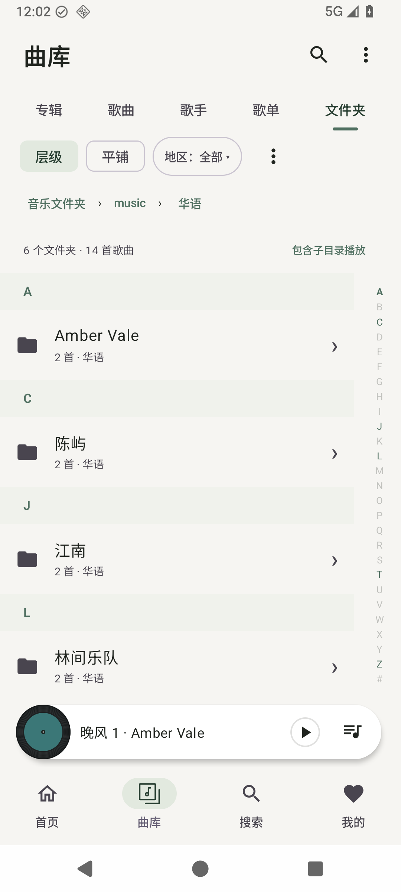
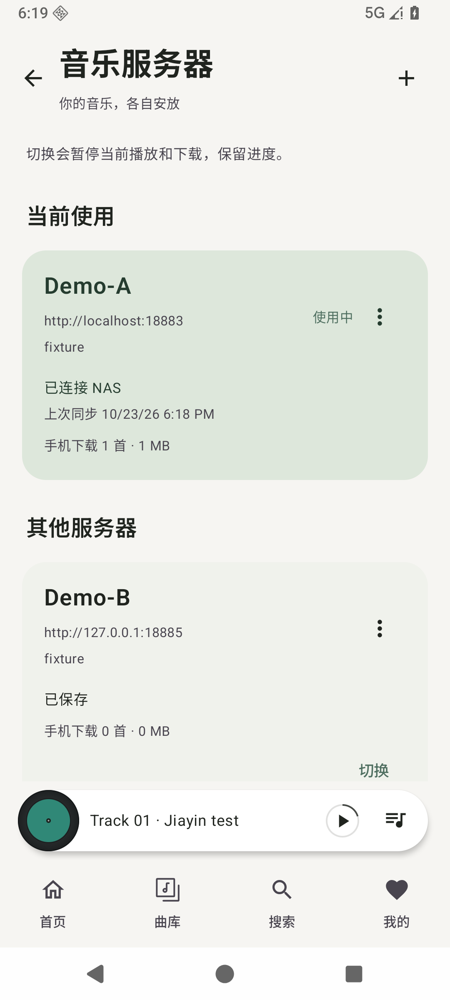
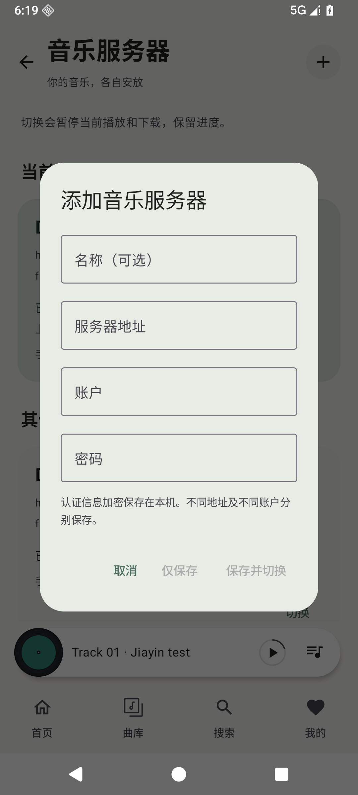
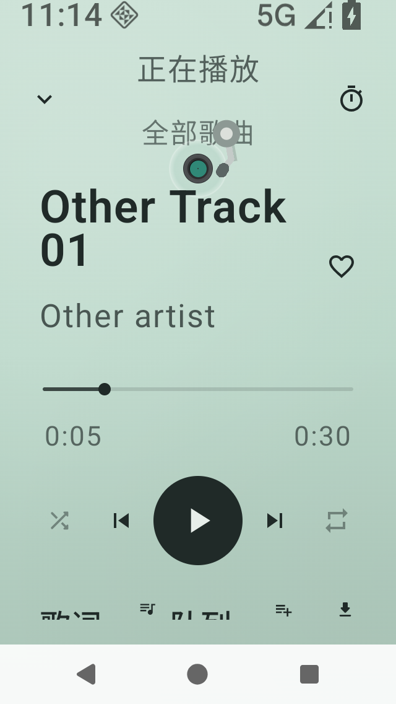
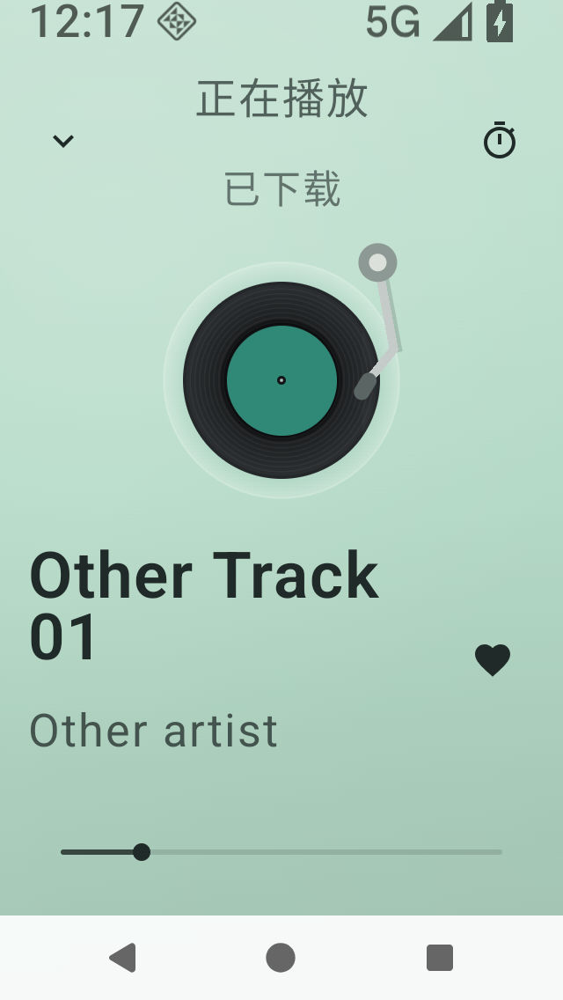
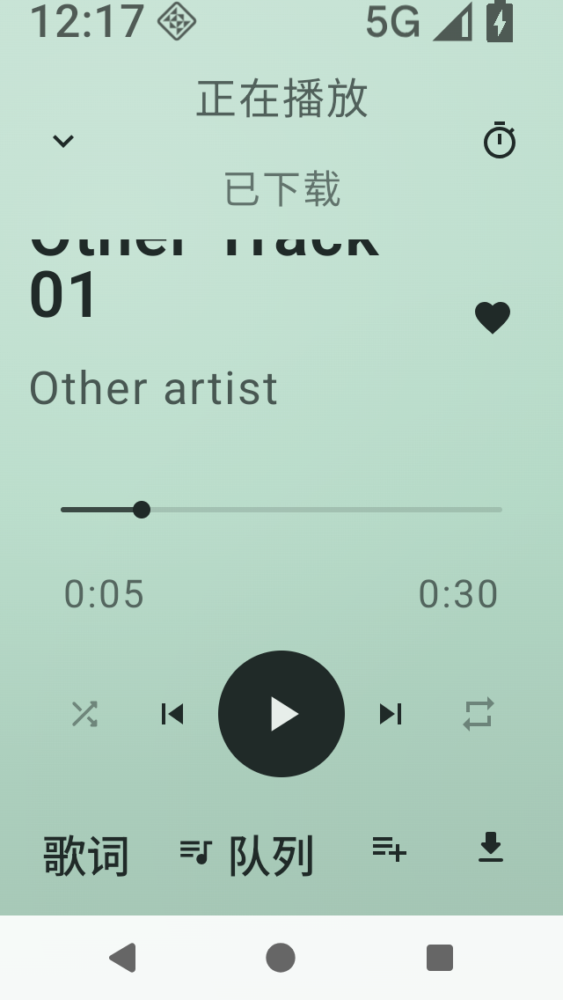
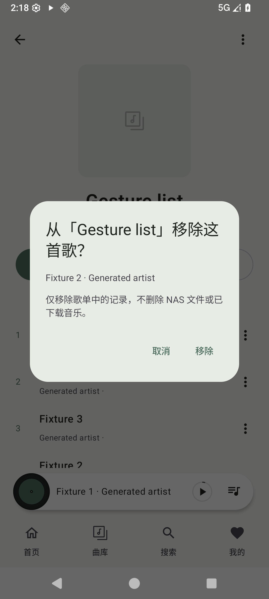
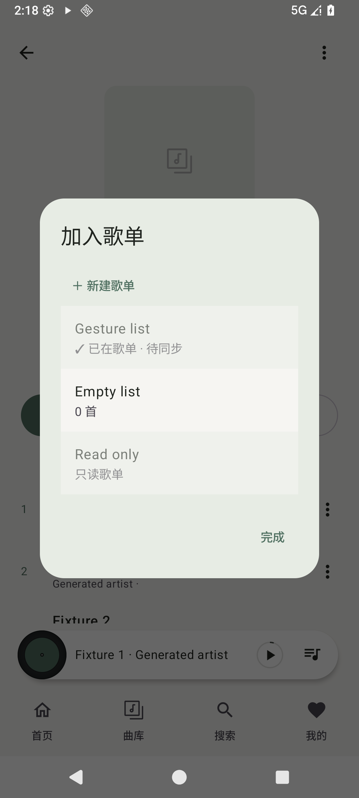

# 界面一览

家音使用米白与浅绿基础色，播放页随封面柔和变色。以下均为生成示例数据的原生 Android 截图，不包含真实用户的服务器或曲库。

## 听歌

  

## 查找音乐

  

## 服务器

 

界面根据可用窗口、字号和键盘状态调整。小屏或大字号时部分内容需要滚动，操作不会因屏幕变窄而消失。参阅[兼容性与验证范围](COMPATIBILITY.md)。

## 窄屏与大字号对比

以下同为 320 × 568dp、200% 字号的签名包截图，使用生成音频与纯色封面。左：preview.8，唱片被压缩且底部操作截断。中：preview.9 保留唱片及文字空间。右：preview.9 用手指上滑后完整显示播放和歌单等操作。大字号允许滚动，不强制缩小字号；顶部栏保持可用。

  

## 歌单快捷操作

左滑歌曲后确认移除；加入歌单时，已收录与只读歌单不可选。下面均为生成曲库的原生截图。

 
