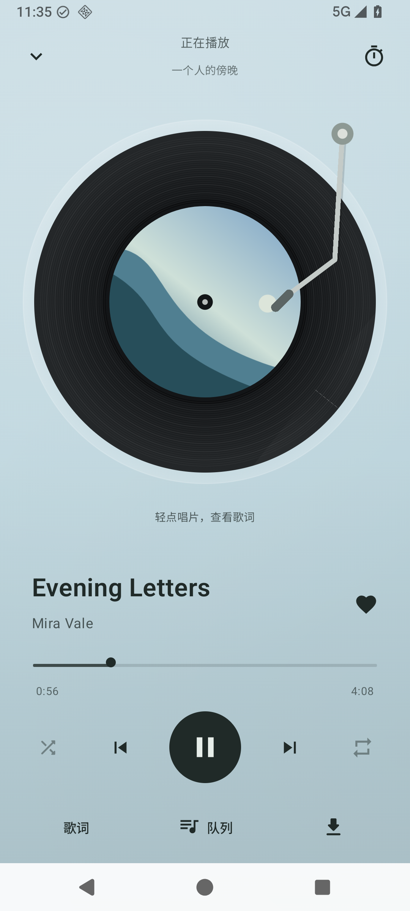
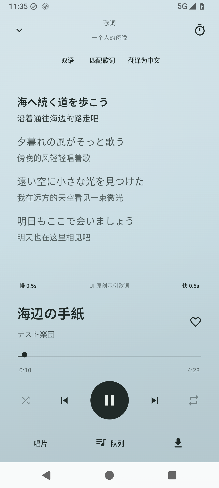
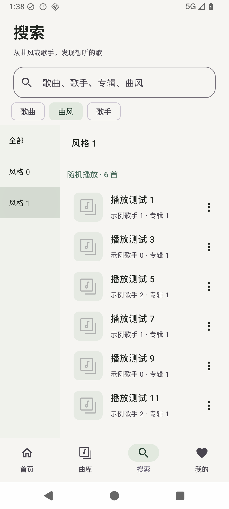
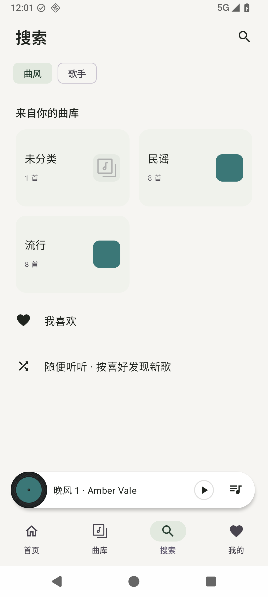
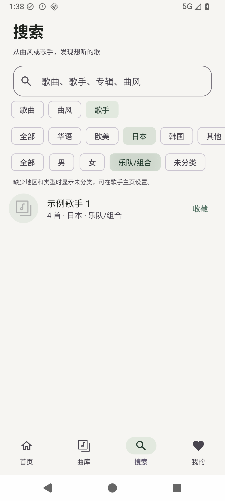
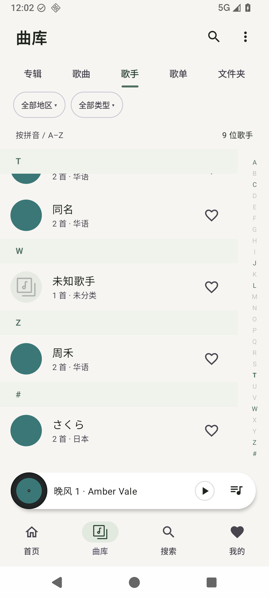

# 原生页面截图

所有封面、音乐、歌词与账户均为生成的测试示例，不来自个人 NAS。

| 页面 | preview.5 | preview.6 |
| --- | --- | --- |
| 播放 |  |  |
| 歌词 |  |  |

新增：[歌手歌曲](artist-songs.png)、[歌手专辑](artist-albums.png)、[歌手分类](artist-categories.png)、[曲风浏览](genres.png)、[下载批量管理](downloads-batch.png)。

## preview.7 搜索与目录

以上截图全部使用生成曲库，原生触摸测试直接截屏。

| 浏览位置 | preview.6 | preview.7 |
| --- | --- | --- |
| 搜索入口 |  |  |
| 歌手分类与定位 |  |  |

独立搜索：[键盘与迷你播放器](search-keyboard.png)、[结果及范围](search-results.png)。目录：[层级](folder-hierarchy.png)、[平铺](folder-flat.png)。[字母拖动提示](index-drag.png)。

[320dp 窄屏／1.3 倍字号／深色主题的字母索引](artist-index-narrow-dark.png)。
